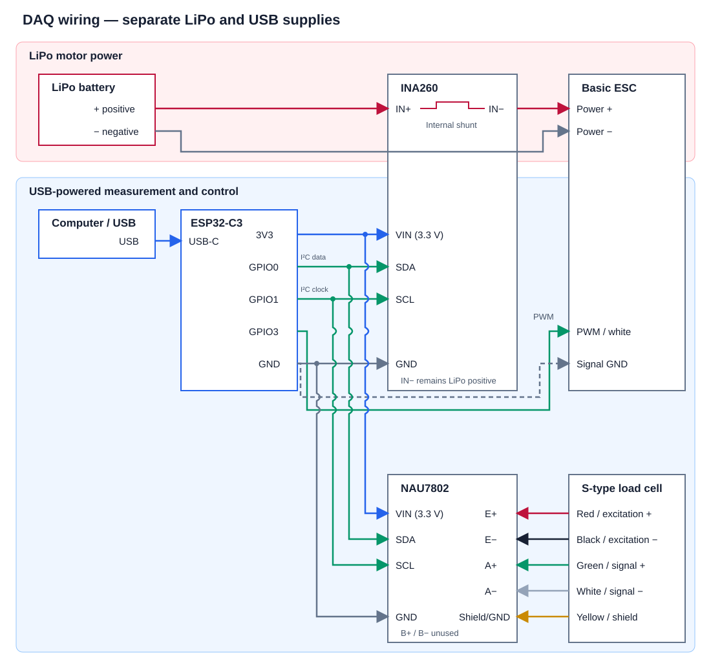
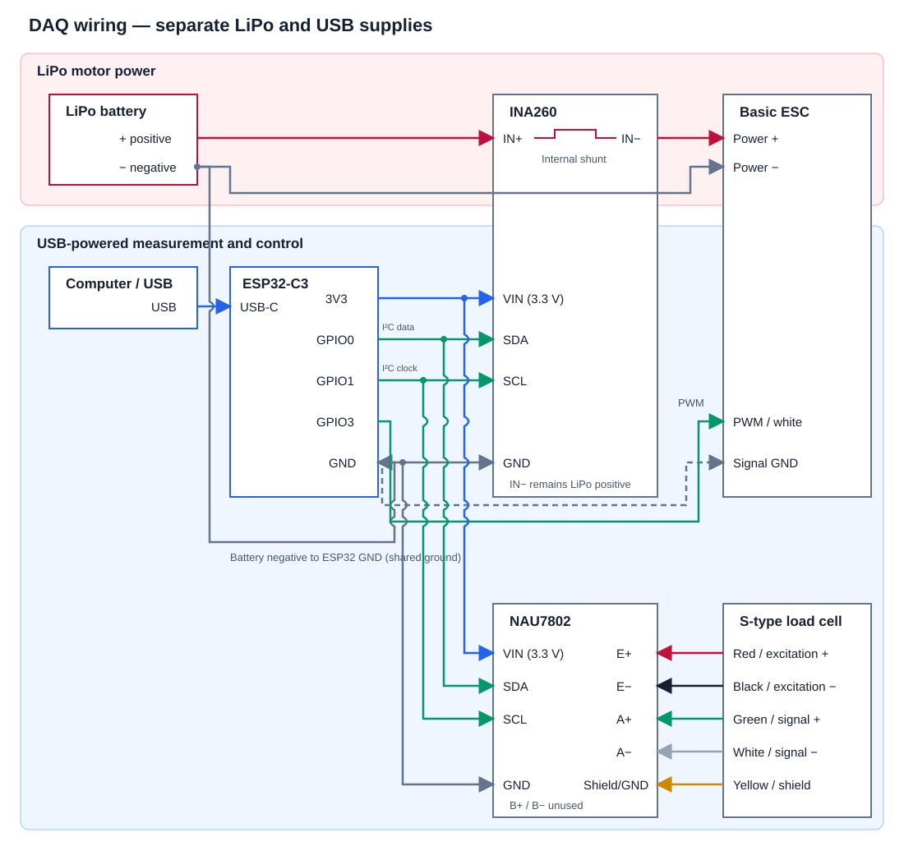

# Thesis DAQ menu firmware

ESP-IDF target: `esp32c3`. Build and flash with the UART flash method, then open
IDF Monitor on the native USB COM port. The ESC starts at 1500 us neutral.
Sensors are read quietly in the background; no measurement stream starts until
selected. Type an option number and press Enter.

Build from an ESP-IDF 6.1 terminal (the version selected in `.vscode/settings.json`):

```powershell
idf.py build
```

After changing ESP-IDF installations, run `idf.py fullclean` followed by
`idf.py build` to refresh cached SDK, Python and bootloader paths. The `build`
directory contains generated files tied to the selected installation.

| Option | Function |
|---|---|
| 1 | Guided multi-point force calibration |
| 2 | Formatted timestamped sensor output |
| 3 | Unformatted timestamped sensor output (CSV) |
| 4 | Fixed PWM table, 30 seconds per step, with step notices only |
| 5 | Fixed PWM table with formatted timestamped force and power |
| 6 | View/change current GPIO assignments |
| 7 | View the fixed PWM table and hold time |
| 8 | Power-controlled test with raw CSV output |
| 9 | Power-controlled test with formatted force (N) and power (W) |
| 10 | View/change power targets, hold times and control limits |
| 11 | Repeat menu options while retaining the current mode |
| 12 | Toggle forward/reverse PWM direction while stopped |

**Type `exit` and press Enter in any mode:** stop printing/recording/testing,
return PWM to 1500 us neutral, and show the original menu. `stop` also does this.
Unlike earlier firmware, a lone `x` is not a stop command; it is part of `exit`.
Finish a mode with `exit` before selecting another option.

Option **11** can be entered in any mode. It repeats the menu without changing
motor output, test timing, calibration collection or settings. A running CSV
mode also reprints its header so a logger can attach without selecting another
output mode. `SerialLogger.py` sends `11` automatically when it connects. An
active test continues; use `exit` to stop it before choosing another mode.

## Wiring and pin settings

| Connection | Default ESP32-C3 Super Mini GPIO |
|---|---|
| Both sensor SDA pins | GPIO0 |
| Both sensor SCL pins | GPIO1 |
| Basic ESC white signal wire | GPIO3 |
| Both breakout VIN pins | 3V3 |
| Both breakout grounds and ESC signal ground | GND |



### S-type load cell to NAU7802

The JLBS-MD-5kg S-type load cell uses the confirmed wiring below. Connect its
signal wires to channel 1 (A), which this firmware reads.

| Load cell wire | NAU7802 terminal | Function |
|---|---|---|
| Red | E+ | Bridge excitation positive |
| Black | E- | Bridge excitation negative |
| Green | A+ | Channel 1 signal positive |
| White | A- | Channel 1 signal negative |
| Yellow | Shield/GND | Cable shield; connect at the ADC end only |
| None | B+ | Leave unconnected; channel 2 signal positive |
| None | B- | Leave unconnected; channel 2 signal negative |

Connect yellow to the breakout's shield terminal, if provided, or circuit GND.
Leave B+/B- unused; they are the channel 2 inputs.

Use option 1 to tare and calibrate into newtons. Tension and compression produce
opposite signs; calibration follows the signed known forces entered.

Wiring reference: [SparkFun NAU7802 hardware overview](https://learn.sparkfun.com/tutorials/qwiic-scale-hookup-guide/hardware-overview).

The ESC requires its own motor power supply; its signal connector does not power
the ESP32. GPIO8/9 share LED/BOOT and boot strapping, and GPIO18/19 are native USB.

In option 6, enter `pins 0 1 3` to set SDA, SCL and ESC respectively. Firmware
accepts three different GPIOs from 0, 1, 3, 4, 5, 6, 7, 10, 20, 21. Remove motor
power before rewiring. Changing pins releases the old bus/device handles,
reinitializes sensors and neutral PWM, and clears force calibration. An unchanged
pin assignment can also reinitialize sensors after correcting their wiring.
Settings apply for this session and revert to the defaults in `main.c` on reboot.

### INA260 supply wiring (+ / -)



Measure the DC supply to the ESC, not the motor phase wires:

| Connection | Wiring |
|---|---|
| Supply positive (+) | Battery/supply + -> INA260 IN+ |
| ESC positive (+) | INA260 IN- -> ESC + |
| Supply negative (-) | Battery/supply - -> ESC - directly |
| USB power | Computer/USB supply -> ESP32 USB-C |
| Sensor electronics power | ESP32 3V3 -> INA260 VIN |
| Signal ground reference | ESP32 GND -> INA260 GND and ESC signal GND |

IN- is the positive supply output toward the ESC, not the battery negative.
The breakout's VIN connects to ESP32 3V3 as shown above; it powers the sensor
electronics, while IN+/IN- carry the measured ESC supply current.
The ESP32 is powered by USB only. Never connect LiPo positive to ESP32 5V/3V3
or INA260 VIN. The dotted ground connection provides the signal reference;
ESC signal GND shares the ESC's battery-negative reference. These power paths
use separate supplies but are not galvanically isolated. Keep the ESC's main
negative return wired directly to the battery so motor current does not flow
through the ESP32 ground wiring.

Follow Adafruit's board/current limits; the INA260's 15 A continuous chip rating
is below the Basic ESC's 30 A rating. Check your propulsion device's current
before routing motor power through the breakout.

## Force calibration (option 1)

Keep propulsion stopped. For a horizontal rig, apply known forces along the
normal thrust axis and through the normal mechanical load path. A fixed pulley
can redirect a hanging mass into a horizontal pull, approximately F = m*g;
include hanger mass and account for pulley friction and the rig geometry.

1. Remove applied force. Enter `tare`, then wait for its point summary.
2. Apply a known force and allow the rig to settle.
3. Enter `point 9.80665` if the applied force is +9.80665 N, for example.
4. Wait for its summary, then repeat `point <newtons>` for other loads.
5. Enter `fit` to fit a straight line across the recorded points.
6. Use `show` to inspect calibration, then `exit` to return to the menu.
7. Use output option 2 to verify zero and additional loads not used in the fit.

Each point averages 40 fresh logged readings (about two seconds). Up to eight
points including zero can be recorded. `fit` needs at least two different points;
several loads and repeated loading/unloading provide a better check. Firmware
prints each point's mean counts, the fitted coefficients and residual errors.

`force_N = (raw_counts - tare_counts) * newtons_per_count`.
The sign follows the known forces you enter. A new `tare` changes zero while
retaining an existing scale factor, and starts a fresh point dataset. `exit`
cancels an unfinished recording but retains completed points and calibration.
Calibration is RAM-only and is lost on reboot. Save the printed coefficients and
point summaries with your experimental records. Startup ADC internal calibration
is separate from calibration into newtons.

## Sensor output (options 2 and 3)

Formatted output uses the requested labels:

```text
Timestamp: 123456 us, Force: 2.500000 N, Voltage: 12.0000 V, Current: 1.0000 A, Power: 12.0000 W, Current PWM: 1500 us
```

Before calibration, Force explicitly shows raw counts and `(uncalibrated)`.
A failed force read displays `unavailable`; failed power reads display `nan`.

CSV output prints a header once, then numeric/status rows:

```text
time_us,force_raw,force_N,voltage_V,current_A,power_W,pulse_us,power_status,force_status,dropped_lines
```

The force_N field is blank until calibrated. Failed force reads have empty fields.
Check for `ESP_OK` in both status columns; `ESP_ERR_NOT_FINISHED` means no fresh
conversion. `dropped_lines` counts output lost to a full USB buffer, including
output before the monitor connects. Commands are echoed in menus/settings, but
not while streaming, keeping typed text out of CSV rows.

## PWM settings and tests (options 7, 4 and 5)

Direction defaults to reverse. From the menu or settings (7 or 10), enter `12`
to toggle it, or use `direction reverse` / `direction forward` to select it.
`direction show` reports it in any mode. Stop with `exit` before changing
direction; a change holds neutral and requires five seconds before a test can
start. Direction applies to both PWM and power-controlled tests and resets on
reboot. Reverse mirrors commands around 1500 us: 1700 becomes 1300 us and 1900
becomes 1100 us. Power-control limits retain their forward-equivalent values in
either direction, so `limits 1700 11 25` needs no conversion.
Settings display the actual table/limit. CSV `pulse_us` and formatted PWM
always report the actual output width; the CSV schema is unchanged.

Options 4 and 5 run the following fixed table in order, holding each pulse width
for **30 seconds** at 50 Hz. Option 7 displays the table; the old
`set <maximum_us> <increment_us> <hold_seconds>` sweep command no longer applies.

| Nominal power (W) | Reverse PWM (us) |
|---:|---:|
| 1 | 1440 |
| 2 | 1398 |
| 3 | 1370 |
| 4 | 1347 |
| 5 | 1326 |
| 6 | 1305 |
| 7 | 1287 |
| 8 | 1270 |
| 9 | 1253 |
| 10 | 1238 |
| 11 | 1223 |
| 12 | 1209 |
| 13 | 1195 |
| 14 | 1180 |
| 15 | 1162 |
| 16 | 1146 |
| 17 | 1131 |
| 18 | 1119 |
| 19 | 1106 |
| 20 | 1100 |

The first pulse is applied immediately after the startup checks, with no extra
neutral test step. Total hold time is **600 seconds (10 minutes)**; completion
returns to 1500 us neutral and the menu. Forward direction mirrors this table
around 1500 us (1560 through 1900 us). The watt labels describe the original
measurements; PWM tests hold the pulse fixed and report live measured power.
Option 4 prints only step/test notices; **option 5** adds formatted measurement
rows with timestamp, force (N when calibrated), voltage, current, power (W), and
actual PWM, using the same format as option 2.
These are throttle pulse widths, not measured RPM. Confirm the powered ESC's
initialization tones before starting a test; firmware enforces five seconds of
neutral after configuring its output.

Tests also stop on sensor errors, data older than 0.5 seconds, and detected USB
disconnection. Closing a terminal may leave USB connected: enter `exit` before
closing it. Software is not a substitute for an accessible motor-power cutoff.

## Power-controlled tests (options 8, 9 and 10)

These tests regulate the **measured DC input power to the ESC** by adjusting the
PWM command in the selected direction. The fin mechanism and T200 can therefore run at the same
input watt targets while using different PWM commands. Power is electrical
input at the INA260 measurement point; it is not mechanical output power.
Use the same supply measurement arrangement for both devices and compare the
actual measured means and repeat runs, rather than assuming targets are exact.

Select option **10** to customize settings. Defaults are 5 through 50 W in 5 W steps, with
five seconds of settled measurement at each target:

```text
set 5 50 5 5
```

The arguments are `set <start_W> <max_W> <step_W> <hold_seconds>`. Start and
increment must be at least 0.001 W with up to three decimal places, the increment must divide the range evenly, and
the maximum must be below the power cutoff. Up to 100 targets and 1..600 seconds
of hold time are accepted. To test one level, use e.g. `set 10 10 1 10`.

Control limits and timing can be changed separately in option 10:

```text
limits 1900 11 55
timing 2 60
show
```

- `limits <max_pwm_us> <current_cutoff_A> <power_cutoff_W>` defaults to 1900 us,
  11 A and 55 W. This allows 50 W targets with headroom before the power cutoff.
  PWM runs from neutral at 1500 us to 1900 us in forward, or 1100 us in reverse.
  The PWM ceiling must be above 1500 and no higher than 1900 us;
  current cutoff must be positive and no higher than 15 A; power cutoff must
  exceed the configured maximum target and be no higher than 500 W. Set limits
  before raising targets. These are software cutoffs on sampled readings,
  not hardware current protection or a validated rating for the whole rig.
  Power-controlled tests stop at measured current **>=11 A** with the default
  cutoff, allowing a roughly 10 A operating target when other limits permit.
  The independent default 55 W cutoff must also be configured for higher-power
  experiments; setting the current cutoff does not raise the watt or PWM limits.
- `timing <settle_seconds> <acquisition_timeout_seconds>` defaults to 2 and 60.
  Settling must be 1..60 s; timeout must be at least settling and at most 600 s.
  A step's total deadline is acquisition timeout + settling + hold time.
- Settings are RAM-only. Review the limits for each motor, mechanism and supply.
  The INA260's [15 A continuous chip rating](https://www.ti.com/lit/ds/symlink/ina260.pdf)
  does not establish the current rating of the breakout, wiring or connectors.

Enter `exit` to return to the menu, then select **8** for CSV output or **9**
for readable newtons and watts. Option 9 requires force calibration; option 8
can retain raw counts for calibration during later analysis. Both modes keep
measured power in watts. The firmware waits for healthy sensors and the existing
five seconds of neutral ESC initialization before permitting a test to start.

The controller starts at neutral and adjusts by at most 2 us every 100 ms using
fresh readings. A low-pass filter (`filtered += 0.2 * (measured - filtered)` at
approximately 20 Hz) smooths cyclic power draw. It holds the command within a
deadband of the larger of 0.25 W or 5% of the target. Settling uses a wider band:
the larger of 0.5 W or 10% of the target (4.5..5.5 W for a 5 W target).
The settling clock starts when filtered power enters this band. After two uninterrupted seconds by default,
rows are marked settled; the hold clock then runs for the configured duration.
Leaving the band or missing a sensor conversion resets both clocks. The
controller continues regulating during the hold. A new target retains the
current command and filter history but starts a new settling period.

CSV mode appends these columns to the existing sensor schema:

```text
target_power_W,filtered_power_W,power_settled,test_step
```

`power_settled` is 0 while approaching/reacquiring the target and 1 during the
measurement hold. Force counts and sensor statuses remain available, and
`force_N` is filled when calibrated. Formatted mode appends the same information:

```text
, Target: 5.000 W, Filtered: 4.950 W, Settled: 1, Step: 1
```

Measurements are printed before the next control correction/target change.
Completion, `exit`/`stop`, USB disconnection, stale sensors (>0.5 s), sensor read
errors, invalid power readings, reversed current, or current/power cutoff returns
the output to neutral. An unreachable/unstable target times out and stops the
test; it is not reported as a completed level. A low PWM ceiling may prevent
reaching a target. Control gains/filtering need physical validation with each
mechanism; the host simulations do not establish stability on the real rig.

Use `SerialLogger.py` option 8 output for automatic CSV files. Its `--no-csv`
or `/csv off` switch disables CSV saving while keeping the terminal log.
`PlotRecording.py` reads both power-test modes and summarizes only settled rows
by target watts, with N/W computed from measured power. Ordinary PWM grouping
would discard useful data because the power controller changes PWM throughout
the run. An external calibration JSON can be applied to raw CSV data in analysis.

## Timing and recording

Data modes print approximately 20 rows/s. INA260 uses triggered voltage/current
conversions, 1.1 ms each, without averaging; after reading, firmware triggers the
next conversion. Power represents the preceding interval, roughly one log period
old. NAU7802 runs at 80 samples/s, gain 128, 3.0 V excitation, channel 1; logging
captures a subset. Timestamp is the read-loop time in microseconds since boot.
Sensors are not sampled simultaneously. PWM widths round to about 1.22 us steps.

For steady thrust-per-watt results, exclude settling after each command change
and divide mean force by mean power over matching settled windows. Check raw
force, sensor status, missing rows and calibration before accepting a run.

In IDF Monitor, press Ctrl+T then Ctrl+L to start/stop saving a log in the project
directory. Keep host timestamps disabled for CSV, and exclude menu/diagnostic
lines when importing data.

## Code and verification

- `main/main.c`: pins, menu, PWM, calibration and experiment loop.
- `main/sensors.c`: native ESP-IDF sensor initialization and register reads.
- `tests/menu_test.c`: actual menu logic exercised with simulated hardware APIs.

On a host with GCC, run:

```text
gcc -std=c11 -Wall -Wextra -Werror -Itests/include tests/menu_test.c -lm -o build/menu_test.exe
build/menu_test.exe
```

The host tests cover silent modes, output formats, `exit`, invalid settings,
all 20 PWM table entries and 30-second holds in both directions, formatted force
and power, direction-change interlocks and neutral dwell, calibration fitting/re-tare,
PWM completion/restart and stale-data shutdown.
Power tests include customizable settings, raw/formatted telemetry, two simulated
motor responses at the same three watt targets, command slew/ceilings, settled
hold timing, missing conversions, cutoffs, reversed/invalid readings and timeout.
Tests also verify that menu option 11 retains mode and motor/test state, refreshes
active CSV headers, and that 10 A is allowed while measured current >=11 A trips
when the independent watt cutoff permits those power levels.
They do not replace checking PWM timing and measurements on the physical rig.

References: [ESP-IDF I2C](https://docs.espressif.com/projects/esp-idf/en/stable/esp32c3/api-reference/peripherals/i2c.html),
[LEDC](https://docs.espressif.com/projects/esp-idf/en/stable/esp32c3/api-reference/peripherals/ledc.html),
[IDF Monitor](https://docs.espressif.com/projects/esp-idf/en/stable/esp32c3/api-guides/tools/idf-monitor.html),
[Basic ESC](https://bluerobotics.com/store/thrusters/speed-controllers/besc30-r3/),
[INA260 datasheet](https://www.ti.com/lit/ds/symlink/ina260.pdf),
[NAU7802 datasheet](https://www.nuvoton.com.cn/export/resource-files/en-us--DS_NAU7802_DataSheet_EN_Rev2.6.pdf),
[INA260 Breakout Board](https://cdn-learn.adafruit.com/downloads/pdf/adafruit-ina260-current-voltage-power-sensor-breakout.pdf),
[NAU7802 Breakout Board](https://cdn-learn.adafruit.com/downloads/pdf/adafruit-nau7802-24-bit-adc-stemma-qt-qwiic.pdf).
